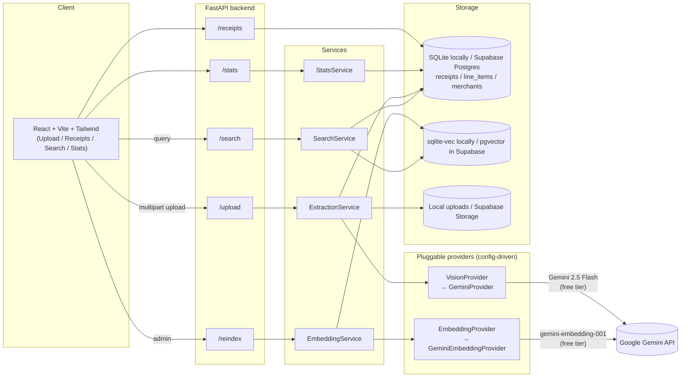

# ReceiptMind

AI receipt OCR + semantic search over your purchase history.

Upload photos or PDFs of receipts. A multimodal model reads each one, extracts
merchant/line-item/total data, validates it, and stores it in a database. Every
line item is embedded so you can search by meaning — "coffee" also finds
lattes, espresso, and cold brew — not just exact keywords.

---

## Architecture



**Key design decisions**

- **No local ML model.** Both receipt reading (vision) and embeddings are
  hosted API calls (Gemini). The backend has no `torch` / `sentence-transformers`
  dependency, so the container is small and starts fast on Render's free tier.
- **Provider abstraction.** `VisionProvider` and `EmbeddingProvider` are
  abstract base classes; swapping providers means adding one class in
  `providers/` or `embeddings/` and one line in `config.py`. The rest of the
  app never imports a concrete provider.
- **One codebase for local and hosted storage.** Local development uses SQLite
  and sqlite-vec. Production uses Supabase Postgres with pgvector and a private
  Supabase Storage bucket for receipt images.
- **Hybrid search via Reciprocal Rank Fusion.** Semantic (cosine similarity
  over embeddings) and keyword (SQL `ILIKE`) results are combined by rank,
  not raw score, since the two scores aren't on comparable scales.

---

## Folder structure

```
receiptmind/
├── backend/
│   ├── api/
│   │   ├── deps.py            # dependency injection wiring
│   │   └── routes/            # upload, receipts, search, stats
│   ├── services/               # extraction, embedding, receipt, search, stats
│   ├── providers/              # VisionProvider ABC + GeminiProvider
│   ├── embeddings/              # EmbeddingProvider ABC + GeminiEmbeddingProvider
│   ├── search/                  # sqlite-vec / pgvector, keyword search, RRF hybrid
│   ├── database/                # SQLAlchemy engine/session, init_db
│   ├── models/                  # Merchant, Receipt, LineItem ORM models
│   ├── schemas/                 # Pydantic: LLM extraction schema + API I/O
│   ├── utils/                   # exceptions, logging, image normalization
│   ├── config.py
│   └── main.py                  # FastAPI app entrypoint
├── frontend/
│   └── src/
│       ├── pages/                # Upload, Receipts, ReceiptDetail, Search, Statistics
│       ├── components/           # Navbar, Toast, Pagination, Status
│       ├── api/client.js
│       └── lib/format.js
├── alembic/                     # versioned schema migrations
├── scripts/seed_sample_data.py  # demo data, no API calls
├── tests/                       # pytest: providers, database, search, api, validation
├── Dockerfile                    # backend container
├── docker-compose.yml            # local full-stack parity
├── railway.json / render.yaml     # backend deploy configs
└── frontend/vercel.json           # frontend deploy config
```

---

## Installation

### Prerequisites

- Python 3.11+
- Node.js 20+
- A free Gemini API key from [aistudio.google.com/apikey](https://aistudio.google.com/apikey)

### Backend

```bash
cd receiptmind
cp .env.example .env
# edit .env and set GEMINI_API_KEY=...

pip install -e ".[dev]"          # or: uv sync
alembic upgrade head              # creates the schema + local sqlite-vec index
python scripts/seed_sample_data.py  # optional: adds 5 demo receipts, no API calls

uvicorn backend.main:app --reload   # or: uv run uvicorn backend.main:app --reload
```

The API is now at `http://localhost:8000` (interactive docs at `/docs`).
If you seeded sample data, run `curl -X POST localhost:8000/reindex` once
you have a real API key set, so the sample line items become searchable.

### Frontend

```bash
cd frontend
cp .env.example .env    # VITE_API_BASE_URL=/api is correct for local dev
npm install
npm run dev
```

Vite proxies `/api/*` to `http://localhost:8000` (see `vite.config.js`), so
open `http://localhost:5173` and everything should just work.

### Tests

```bash
pip install -e ".[dev]"
pytest                # 37 tests, no network calls (providers are faked)
ruff check backend/
mypy backend/
black --check backend/
```

---

## Configuration

All config is environment-driven — see `.env.example` for the full list.
The important ones:

| Variable | Purpose |
|---|---|
| `GEMINI_API_KEY` | Free key from AI Studio; used for both extraction and embeddings |
| `VISION_PROVIDER` | `gemini` today; add a new value + provider class to switch |
| `EMBEDDING_PROVIDER` | Same pattern, for embeddings |
| `DATABASE_URL` | `sqlite:///./data/receiptmind.db` locally; use Supabase's Postgres URL in production |
| `CORS_ORIGINS` | Comma-separated list; add your deployed frontend URL |
| `SUPABASE_URL` | Supabase project URL for receipt image storage |
| `SUPABASE_SERVICE_ROLE_KEY` | Server-only Supabase key; never put it in Vercel |
| `SUPABASE_STORAGE_BUCKET` | Private Storage bucket name (default `receipts`) |

---

## Running with Docker

```bash
docker compose up --build
```

This builds and runs both the backend (port 8000) and a static-served
frontend build (port 4173) with a named volume for the SQLite file and
uploaded images.

---

## Deployment

**Backend — Render free**

Render builds the root `Dockerfile`. The free service sleeps after inactivity,
so its first request may take about a minute. Receipt data and images live in
Supabase and persist across Render restarts.

1. Push this repo to GitHub.
2. Create a Supabase project and a **private** Storage bucket named `receipts`.
   The backend enables the `vector` extension and creates application tables.
3. Copy the Supabase Postgres connection string and project URL. For SQLAlchemy,
   use the `postgresql+psycopg://` driver prefix.
4. Create a Render web service from this repo. `render.yaml` defines the free
   Docker service and environment variables. Set `DATABASE_URL`, `SUPABASE_URL`,
   `SUPABASE_SERVICE_ROLE_KEY`, and `GEMINI_API_KEY` in Render. Keep the
   service-role key only on the backend.
5. Set `CORS_ORIGINS` to the Vercel production domain (and any preview domains
   you need to use).

**Frontend — Vercel**

1. Import this repository as a Vercel project and set its Root Directory to
   `frontend/` (`vercel.json` is configured for the Vite build).
2. Set `VITE_API_BASE_URL` to your deployed backend URL (e.g.
   Render backend URL) in Vercel's environment
   variables. Vite inlines this at build time, so redeploy after changing it.

Supabase Free has database and file-storage quotas and may pause inactive
projects; check the current plan limits before relying on it for important
records.

---

## API reference

Full interactive docs (OpenAPI/Swagger) are auto-generated at `/docs` once
the backend is running. Summary:

| Method | Path | Description |
|---|---|---|
| `POST` | `/upload` | Upload one or more receipt images/PDFs (multipart, field name `files`) |
| `GET` | `/receipts` | Paginated, filterable, sortable receipt list |
| `GET` | `/receipts/{id}` | Full receipt detail including line items |
| `DELETE` | `/receipts/{id}` | Delete a receipt and its embeddings |
| `POST` | `/search` | `{query, mode: semantic\|keyword\|hybrid, ...filters}` |
| `POST` | `/reindex` | Re-embed every line item (e.g. after changing embedding model) |
| `GET` | `/stats` | Spending totals, monthly trend, merchant/category frequency |
| `GET` | `/health` | Liveness check |

---

## Screenshots

*(placeholder — add screenshots of the Upload, Receipts, Search, and
Statistics pages here once you've run it against real receipts)*

---

## Quality benchmarks

The offline evaluator compares saved predictions with human-verified receipt
transcriptions and search relevance judgments. It reports field accuracy,
amount error, line-item precision/recall/F1, Recall@K, MRR, nDCG@K, and simple
qualitative bands. See [`benchmarks/README.md`](benchmarks/README.md) for the
input format and run it with `python scripts/evaluate_quality.py results.json`.
There are no claimed model-quality scores until a labeled evaluation set is
collected.

---

## Future improvements

- Duplicate detection across near-identical (not just byte-identical) images
- CSV / Excel export of receipts and line items
- Manual editing of extracted fields from the Receipt Detail page
- Confidence-score-based review queue (surface low-confidence receipts first)
- Batch upload progress via a real job queue (Celery/RQ) instead of
  `BackgroundTasks`, for larger batches
- Additional vision/embedding providers (Groq, OpenRouter, GLM) — the
  abstraction is already in place, just needs a new class + config value
